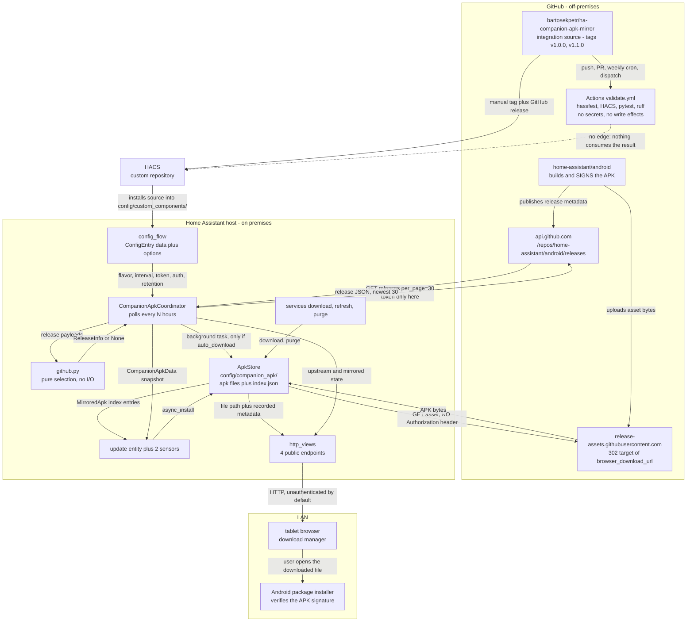
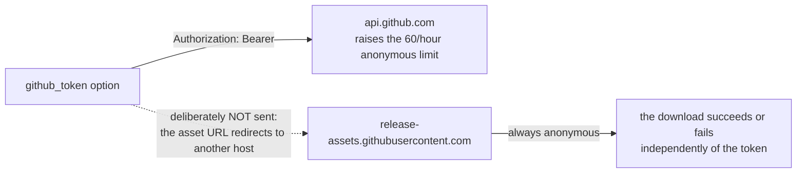
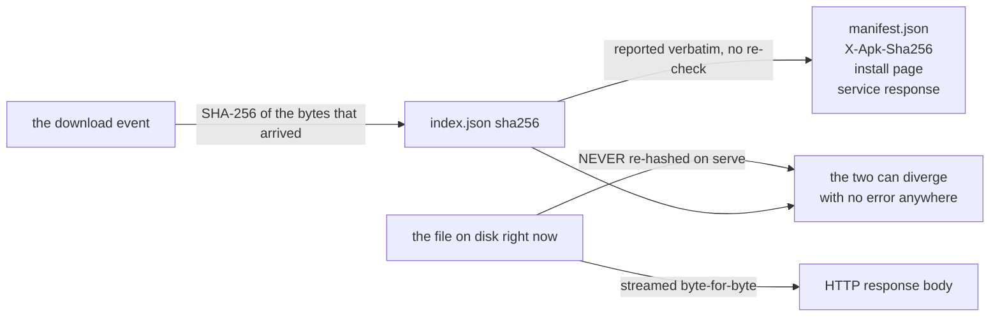
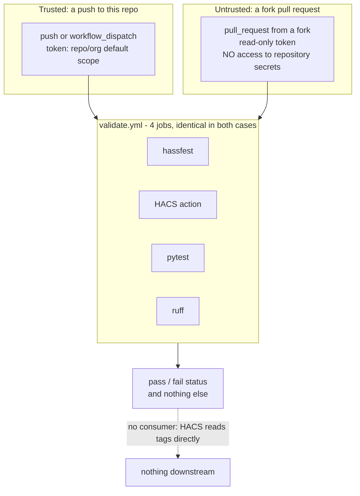

# Architecture — the mirror pipeline and where provenance actually lives

What this project is made of, where an artifact's identity is established, where
it could be substituted, and which way data moves across every edge.

*Diagram current as of `f4e1409` — 2026-11-19.* First revision; kept up to date
by the "Architecture diagram upkeep — ha companion apk mirror" routine, which
re-checks this file against the commits made since that baseline whenever work
happens in the project.

Derived entirely from the code, config, CI workflow, tests and docs in this
repository at `f4e1409`. No live system was touched: no call was made to
`api.github.com`, no APK was downloaded, no Android device was contacted. §8 is
the honest confidence table and it names what was never probed rather than
drawing it as if it had been.

---

## 0. The correction that reframes everything below

There are **two pipelines in this repository, and they do not touch each
other**:

| | **Pipeline A — the artifact mirror** | **Pipeline B — the integration's own code** |
|---|---|---|
| what moves | the companion app APK | this repo's Python source |
| where it runs | **inside the user's house, at Home Assistant runtime** | GitHub → HACS → the user's config dir |
| who triggers it | a timer in `coordinator.py`, or a service call | a human pushing a commit and cutting a tag |
| CI involvement | **none** | `validate.yml` runs, and gates nothing |

**No GitHub Actions workflow in this repository fetches, mirrors, re-publishes
or releases an APK.** The only workflow (`.github/workflows/validate.yml`) runs
hassfest, the HACS action, pytest and ruff against the Python source. The
fetch-and-republish happens at runtime, on the user's own Home Assistant host,
under that host's network identity and filesystem permissions.

That matters for provenance because it moves the entire trust boundary off
GitHub's infrastructure and onto the Home Assistant host. There is no CI
identity, no signing step and no attestation anywhere in Pipeline A. §3 and §4
are about Pipeline A; §5 is the permission boundary of Pipeline B's workflow.

---

## 1. The whole system

```
 ══════════════ GitHub — off-premises, not operated by this project ══════════════

  home-assistant/android                 bartosekpetr/ha-companion-apk-mirror
  ┌────────────────────────────┐         ┌────────────────────────────────────┐
  │ builds and SIGNS the APK   │         │ THIS REPO — integration source     │
  │ with the HA project key    │         │ custom_components/companion_apk/   │
  │   │ publishes a release    │         │ tags: v1.0.0, v1.1.0               │
  │   ▼                        │         └──┬──────────────────────┬──────────┘
  │ app-<flavor>-release.apk   │            │ push · PR · Mon 04:00│ tag +
  │ version_code.txt           │            ▼ UTC · dispatch       │ release
  └────┬──────────────────┬────┘      ┌──────────────────────┐     │ (manual)
       │ metadata         │ bytes     │ Actions validate.yml │     │
       ▼                  ▼           │ hassfest · HACS      │     ▼
 ┌──────────────┐ ┌──────────────────┐│ pytest · ruff        │ ┌────────────┐
 │ api.github   │ │ release-assets.  ││ NO secrets           │ │ HACS       │
 │   .com       │ │ githubusercontent││ NO write effects     │ │ custom     │
 │ /repos/home- │ │   .com           ││ GATES NOTHING        │ │ repository │
 │ assistant/   │ │ (302 target of   │└──────────────────────┘ └─────┬──────┘
 │ android/     │ │ browser_download │                               │
 │ releases     │ │ _url)            │                               │
 └──────┬───────┘ └────────┬─────────┘                               │
        │ HTTPS            │ HTTPS, NO Authorization header          │ installs
        │ token if         │ ON PURPOSE (redirects off-host)         │ source
        │ configured       │                                         │ into
 ═══════╪══════════════════╪═════════════════════════════════════════╪════════
        │   on premises: the Home Assistant host and its LAN         │
        ▼                  ▼                                         ▼
 ┌──────────────────────────────────────────────────────────────────────────┐
 │ Home Assistant                    config/custom_components/companion_apk │
 │                                                                          │
 │  config_flow ──writes──▶ ConfigEntry  (data + options, single instance)  │
 │                               │ re-read on every access                  │
 │                               ▼                                          │
 │  ┌────────────────────────────────────────────────┐                      │
 │  │ CompanionApkCoordinator                        │                      │
 │  │ polls every N h (default 6, allowed 1–168)     │                      │
 │  │ _releases_cache = last 30 release payloads     │                      │
 │  └──┬──────────────────────────────┬──────────────┘                      │
 │     │ pure decision                │ spawns a background download task,  │
 │     ▼                              ▼ only when auto_download is on       │
 │  ┌───────────────┐   ┌──────────────────────────────────────┐            │
 │  │ github.py     │   │ ApkStore                             │            │
 │  │ no I/O,       │   │ <config>/companion_apk/              │            │
 │  │ no HA import  │   │   home-assistant-companion-*.apk     │            │
 │  │ parse/select/ │   │   index.json                         │            │
 │  │ sort releases │   │ stream ▸ .part ▸ byte-count check ▸  │            │
 │  └───────────────┘   │ os.replace ▸ record SHA-256          │            │
 │                      └──┬───────────────────────────────┬───┘            │
 │                         │ read                          │ read           │
 │  ┌──────────────────────┴───┐   ┌───────────────────────┴──────────────┐ │
 │  │ entities (entity.py)     │   │ http_views — 4 views, all registered │ │
 │  │  update.companion_…      │   │ with requires_auth = False ALWAYS;   │ │
 │  │  sensor.…latest_release  │   │ the auth option is enforced INSIDE   │ │
 │  │  sensor.…mirrored_version│   │ each handler                         │ │
 │  │  install ────────────────┼─┐ │  /api/companion_apk/         (HTML)  │ │
 │  └──────────────────────────┘ │ │  /api/companion_apk/latest.apk       │ │
 │  ┌──────────────────────────┐ │ │  /api/companion_apk/apk/{version}    │ │
 │  │ services: download /     ├─┤ │  /api/companion_apk/manifest.json    │ │
 │  │ refresh / purge          │ │ └───────────────────┬──────────────────┘ │
 │  └──────────────────────────┘ │                     │                    │
 │                               └──▶ ApkStore.async_download               │
 └───────────────────────────────────────────────────┬──────────────────────┘
                                                     │ plain HTTP and
                                                     │ unauthenticated
                                                     │ by default
                                                     ▼
                                   ┌─────────────────────────────────────┐
                                   │ tablet browser / download manager   │
                                   │                 │                   │
                                   │                 ▼                   │
                                   │ Android package installer           │
                                   │ VERIFIES THE APK SIGNATURE  ◀────── the only
                                   └─────────────────────────────────────┘ cryptographic
                                                                          identity check
                                                                          in the chain

  build-time only, not on any data path:
    brand/icon.svg ──▶ scripts/render_brand_icon.py ──▶ custom_components/.../brand/*.png
    brand/icon.svg ──▶ (hand-inlined copy) ──────────▶ http_views.ICON_SVG
                       tests/test_brand_icon.py asserts the two stay in step
```

Same graph in Mermaid, with every direction made explicit:



---

## 2. Component → responsibility

| component | owns | notes |
|---|---|---|
| `const.py` | the **only** place upstream asset names, API URLs, limits and public URL paths are written down | `FLAVOR_ASSETS` is a hardcoded five-entry table. If upstream renames an asset, this file is the entire blast radius. |
| `github.py` | release **decisions**: version parsing, ordering, draft/prerelease/asset gates | No I/O, no Home Assistant import. Loaded standalone by `tests/test_logic.py`. |
| `coordinator.py` | the poll loop, option resolution, the auto-download trigger, download-progress fan-out, the 30-release cache | Reads options on every access (`options` then `data` then default), so a reload is not needed for a value to take effect — but the entry *is* reloaded on any option change. |
| `store.py` | **all** disk state and the **only** fetch of APK bytes | Owns `<config>/companion_apk/`: the `.apk` files and `index.json`. Both writes are atomic (`.part` → `os.replace`, `.json.tmp` → `os.replace`). |
| `http_views.py` | the **only** public surface: 4 views, plus the self-contained install page | Registered once per Home Assistant *process*, never unregistered. |
| `entity.py` | device identity and absolute-URL construction | `local_url()` tries the internal URL first, then external, then gives up and returns the bare path. |
| `update.py` | the Install button, progress, release notes, specific-version install | A projection of coordinator + store. Installs nothing on any device. |
| `sensor.py` | two read-only projections: newest upstream, newest mirrored | |
| `config_flow.py` | the **only** writer of the config entry; pre-flight validation against GitHub | Single instance, enforced twice (`_async_current_entries` and a `DOMAIN` unique id). |
| `__init__.py` | entry setup/teardown and the three services | Services are removed only when the last entry unloads. |
| `.github/workflows/validate.yml` | a CI signal **for humans** | hassfest, HACS action, pytest, ruff. Not on any artifact path. See §5. |
| `brand/` + `scripts/render_brand_icon.py` | the integration's own icon, generated at build time | Not imported at runtime. The install page carries a hand-inlined copy of the SVG. |
| `docs/tablet-setup.md` | the consumer-side runbook (tap, ADB, automated ADB, rollback) | Describes behaviour outside this system's control. |
| `hacs.json`, `manifest.json` | distribution and Home Assistant metadata | `manifest.json` version is bumped by hand; see §6. |

### What is explicitly *not* part of this system

- **Any build step for the APK.** Nothing compiles, repackages, re-signs or
  rewrites the artifact. It is relayed byte-for-byte.
- **Any signature or checksum *verification*.** `grep -rn sha256 custom_components/`
  returns only sites that **compute** or **report** a hash. There is no
  comparison against an expected value anywhere in the repository. See §4.
- **Any workflow that fetches or republishes an APK.** There is none. See §0.
- **Any release automation for the integration itself.** The version bump, the
  tag and the GitHub release are manual.
- **Anything that installs the APK on a device.** The mirror serves a file; the
  tablet installs it.
- **Any knowledge of what version a tablet is running.** The update entity
  compares mirror-vs-upstream, never device-vs-upstream.
- **Any Home Assistant state, token or configuration behind the public
  endpoints.** They serve exactly the public APK and its metadata.
- **Any external asset in the install page.** The icon is a `data:` URI, so the
  page renders on a tablet with no internet and cannot change under you.
- **Any upstream other than `home-assistant/android`**, and any flavor outside
  the five in `FLAVOR_ASSETS`.

### Which surfaces survive a component being removed

| removed | what still works |
|---|---|
| `http_views.py` | Entities, services and auto-download all keep working. The tablet loses every way to get the file over HTTP. Note the inverse: the routes **survive the config entry being unloaded** and answer `503` for the rest of the process's life. |
| `update.py` | Everything except the Install button, progress and release notes. |
| `sensor.py` | Everything else. |
| the poll (interval set to 168 h) | The services and the HTTP endpoints still work on demand; automatic discovery effectively stops. |
| `github.py` | Nothing. Every release decision in the codebase routes through it. |
| `store.py` | Nothing. It is both the fetcher and the sole owner of disk state. |
| `config_flow.py` | Nothing — the integration is config-entry-only, with no YAML path. |
| `.github/workflows/validate.yml` | **The whole product, unchanged, including its distribution.** HACS does not read CI status; a red build does not stop an install. |
| `brand/` + `scripts/render_brand_icon.py` | The integration works and the **install page keeps its icon** (inlined in `http_views.py`). `tests/test_brand_icon.py` fails and the Settings UI falls back to the generic placeholder. |

---

## 3. The load-bearing path — upstream release to installed app

Every gate and transform between an upstream publish and an app running on a
tablet:

```mermaid
graph LR
    A["upstream build<br/>APK signed with the HA project key"] -->|"identity ESTABLISHED here"| B["GitHub release asset"]
    B -->|"gate 1: asset name must equal<br/>the FLAVOR_ASSETS entry for the flavor"| C["asset metadata<br/>browser_download_url and size"]
    C -->|"gate 2: not a draft;<br/>prerelease only if opted in"| D["ReleaseInfo"]
    D -->|"gate 3: is_newer beats the mirror,<br/>or an explicit version was named"| E["download decision"]
    E -->|"gate 4: HTTPS plus raise_for_status"| F["streamed bytes into file.part"]
    F -->|"gate 5: byte count equals asset size<br/>SKIPPED when the API reports size 0"| G["os.replace into file.apk"]
    G -->|"transform: SHA-256 COMPUTED,<br/>never compared to anything"| H["index.json entry"]
    H -->|"gate 6: Path.is_file only<br/>NO re-hash of the file"| I["FileResponse plus X-Apk-Sha256"]
    I -->|"plain HTTP, no auth by default"| J["tablet download"]
    J -->|"identity CHECKED here:<br/>signature vs the installed app"| K["installed app"]
```



Four properties of this chain decide whether the mirror is trustworthy, and
three of them are the opposite of what the surface suggests.

### 3.1 Where identity is established — and where it is not

| place | what happens | cryptographic? |
|---|---|---|
| upstream build | the APK is signed with the Home Assistant project's key | **yes** — and it happens in `home-assistant/android`, not here |
| `api.github.com` | metadata arrives over TLS; GitHub's CA chain is the only authority | transport only |
| the asset download | bytes arrive over TLS from a redirect target; no pinning | transport only |
| `store.async_download` | `raise_for_status`, then a byte-count equality check against `asset.size` | **no** |
| `index.json` | SHA-256 of the bytes that arrived is recorded | **no** — it is a *description*, not a check |
| serving (`_apk_response`) | `Path.is_file()`, then stream the file | **no** |
| the tablet | **Android's package installer verifies the APK signature** against the installed app's, or against the user's trust decision on a first install | **yes** |

**The mirror does not establish identity. It preserves bytes and reports a hash
of them.** Identity is established upstream at signing and checked downstream at
install. Everything in between is a transparent, unverifying relay.

This is the single most important fact in the document, and it is
counterintuitive precisely because `manifest.json`, the install page and the
`X-Apk-Sha256` header all *look* like provenance. They are not. A SHA-256 that
you compute yourself over bytes you just accepted, and then publish next to
those same bytes, proves nothing about where they came from — it only lets a
consumer confirm the transfer was not corrupted in the last hop.

What the hash **is** genuinely good for: `docs/tablet-setup.md` tells you to
`curl` `manifest.json` and `sha256sum` the download, which detects LAN-side
corruption or truncation on the HA-to-tablet hop. That is a real property. It is
just not provenance.

### 3.2 Where an artifact could be substituted

Ranked by how little the attacker needs.

| # | substitution point | what it takes | does the published SHA-256 give it away? |
|---|---|---|---|
| 1 | **the LAN hop** — the endpoints are plain HTTP and unauthenticated by default, and the documented flow is `http://homeassistant.local:8123/...` | ARP or DNS spoofing on the tablet's network | No. The attacker serves their own hash too. Android's signature check still blocks *replacing* a GitHub-signed install, but a **first** install is accepted once the user allows unknown apps. |
| 2 | **the mirror directory** — `<config>/companion_apk/` | write access to the Home Assistant config dir | **No, and this is the sharp edge.** The serving path checks `Path.is_file()` and never re-hashes. Swap the `.apk` and `manifest.json` plus `X-Apk-Sha256` keep reporting the **original** hash. The header describes the download event, not the file in the response body. |
| 3 | **`index.json`** — same directory | same as #2 | `filename` is sanitised by `_sanitize_component` when it is **written**, never when it is **read**. A hand-edited `index.json` whose `filename` escapes the directory is accepted by `MirroredApk.from_dict`, passes the `is_file()` check and is streamed with an APK content type. Reasoned from the code, not attempted — see §8. |
| 4 | **TLS interception** on the HA host's egress | a CA the host trusts, plus a position on the path | No. No pinning, no expected hash, so a successful intercept produces an accepted artifact whose recorded hash matches the substituted bytes. |
| 5 | **the upstream release asset** | control of the upstream release | No. A GitHub release asset can be deleted and re-uploaded under the same name on the same tag. Whatever bytes sit behind the URL at fetch time are what gets mirrored. |

#2 and #3 need write access to the Home Assistant config directory, which is
already a full compromise of Home Assistant — they are defence-in-depth notes,
not new attack surface. They matter because the *documented verification
procedure* (`sha256sum` against `manifest.json`) silently stops detecting
anything in exactly that case, and because that is not obvious from reading the
feature list.

One genuine mitigation is already in place, by accident of ordering: an
already-mirrored version is **never re-fetched** (`store.py` returns the
existing entry early), so a re-uploaded upstream asset for a version already on
disk cannot replace the local copy. The flip side is that it also cannot deliver
a legitimate upstream re-roll of the same version number.

### 3.3 Direction asymmetries

**The GitHub token goes one way only.**



So adding a token fixes rate-limited *discovery* and changes nothing about the
*download*. It also means a private release asset could never be mirrored. The
asymmetry is intentional and commented in `store.py`.

**The recorded hash describes the past, the response body describes the
present.**



**`latest.apk` is flavor-filtered; `/apk/{version}` is not.** The versioned view
resolves through `store.get(version)` with no flavor argument, so if two flavors
are on disk — possible after switching the option, because a flavor-scoped purge
leaves other flavors untouched — a versioned URL can hand out a build for a
flavor the entry is no longer configured for. `latest.apk` cannot.

**The poll that triggers a download reports the state from before it.**
`_async_update_data` spawns the download as a background task and returns a
snapshot carrying the *old* `mirrored` value. The mirrored sensor only moves when
the download finishes and calls `async_set_updated_data`. Never conclude failure
from the refresh that started the work.

**`installed_version` is the mirror, not any device** — and when the mirror is
empty it is the string `"none"`, not `None`, so Home Assistant renders the
entity as available and keeps the Install button clickable in exactly the case
where it is needed.

**`requires_auth` is always `False`; the auth option is enforced in the
handler.** All four views read `request["hass_user"]` themselves, so toggling
**Require Home Assistant authentication** takes effect without a restart and
without changing route registration.

---

## 4. Per-component in / out

| component | reads | publishes | over which interface |
|---|---|---|---|
| `config_flow.py` | the user's form input; a live release list from `api.github.com` as a pre-flight | the config entry's `data` / `options` | Home Assistant config-flow UI; HTTPS out |
| `coordinator.py` | the entry's options; the newest 30 release payloads | `CompanionApkData(latest, mirrored)`; progress percentages; a background download task | `DataUpdateCoordinator` listeners; HTTPS out to `api.github.com` |
| `github.py` | raw release dicts | `ReleaseInfo`, or `None` | in-process function calls only |
| `store.py` | `index.json`; the asset URL; `version_code.txt` | the `.apk` files; `index.json`; `MirroredApk` records | filesystem; HTTPS out to the asset host |
| `update.py` | coordinator snapshot; store state; progress callbacks | `installed_version`, `latest_version`, `release_url`, release notes, `local_url`, `install_page`, `version_code`, `sha256` | Home Assistant entity + update platform |
| `sensor.py` | the same two sources | upstream version and its attributes; mirrored version with filename, size, SHA-256, `versionCode`, `mirrored_at`, `available_versions`, `mirror_path` | Home Assistant entity state |
| `http_views.py` | the loaded entry's coordinator (resolved per request, never captured); store files and records | the HTML install page; APK bytes with `X-Apk-Version` / `-Sha256` / `-Flavor`; `manifest.json` | Home Assistant's HTTP server, `/api/companion_apk/*` |
| `__init__.py` | service-call data | `download` and `purge` return a response; `refresh` does not | Home Assistant service registry |
| `validate.yml` | the repo at the pushed commit; live hassfest and HACS schemas | a pass/fail status and nothing else | GitHub Actions |

---

## 5. Trust and permission boundary of the CI workflow

`.github/workflows/validate.yml`, four independent jobs on `ubuntu-latest`.

| property | value | consequence |
|---|---|---|
| triggers | `push` (any branch), `pull_request`, `schedule` Mon 04:00 UTC, `workflow_dispatch` | The weekly run exists to catch drift with no commit — see §6. |
| `permissions:` block | **absent** | The `GITHUB_TOKEN` gets the **repository/organisation default**, which is a GitHub *setting*, not a file in this repo. Not determinable from here; §8 marks it never probed. |
| `secrets.*` references | **zero** | Nothing in the pipeline needs a secret, so there is nothing for a fork PR to exfiltrate. |
| fork-PR trigger | `pull_request`, **not** `pull_request_target` | **This is the load-bearing line.** Fork code runs against the merge ref with a read-only token, no repository secrets and no push ability. Changing this one word to `pull_request_target` would run untrusted fork code with the base repo's token and secrets. |
| write side effects | **none** — no release, no publish, no commit, no artifact upload, no deploy | |
| anything downstream consuming the result | **nothing** | HACS reads the repo's tags and releases directly. A red build does not block an install. |
| action pinning | `home-assistant/actions/hassfest@master`, `hacs/action@main` — **mutable branches**; `actions/checkout@v7`, `actions/setup-python@v7` — mutable tags; `astral-sh/ruff-action@v4.1.0` — the only patch-pinned one | Third-party code can change under four of the five refs with nobody acting. §6. |



Because there are no secrets and no write effects, the boundary currently holds
**by absence rather than by configuration**. It would be broken by adding a
secret, adding a write permission, or switching to `pull_request_target` — not
by anything in the workflow as it stands.

---

## 6. Change exposure

### Changes that happen with nobody acting

| what changes | trigger | window |
|---|---|---|
| **the mirrored APK, and the deletion of an older one** | upstream publishes a release and `auto_download` is on (**the default**) | ≤ the scan interval, default 6 h. No approval step. The purge to `keep_versions` (default 2) runs in the same lock. |
| **release-notes text rendered in the Home Assistant frontend** | upstream edits a release body | next poll. Upstream-controlled Markdown, rendered in the HA UI. |
| **which release is "latest"** | upstream publishes, retags or deletes a release | next poll |
| **hassfest / HACS verdict** | both actions validate against **live** upstream schemas | any run, including the weekly cron with no commit |
| **what four of the five CI actions actually execute** | `@master`, `@main` and `@v7` are mutable refs | any run |
| **the Python version CI tests on** | `python-version: "3.13"` is pinned, and `requirements-test.txt` pins `pytest-homeassistant-custom-component==0.13.316` exactly | **nothing drifts here.** The cost is the mirror image: a breaking change in a newer Home Assistant is invisible until someone bumps that pin. |

### What has no rollback

| thing | why |
|---|---|
| **a purged APK** | the file is deleted. Re-fetching works only while that version is still inside the newest 30 releases (`RELEASES_PAGE_SIZE`); after that the version is gone from the mirror's reach entirely. |
| **an Android install** | Android enforces a monotonic `versionCode`. Downgrading requires an uninstall, which clears app data. |
| **the first switch away from a Play Store or F-Droid build** | different signing key, so the existing app must be uninstalled; its local settings and Home Assistant login are lost. One-way. |
| **a mutable-ref action that changed behaviour** | nothing records which commit of `hassfest@master` a past green run used. A previously green commit cannot be re-validated identically. |
| **the integration's own version** | the `manifest.json` bump, the tag and the GitHub release are three manual steps with no workflow behind them and no check that they agree. A tag pointing at a commit whose `manifest.json` says something else is possible and would not be caught. |

---

## 7. Failure attribution

| symptom | suspect | why |
|---|---|---|
| update entity shows installed `none` | **not a fault** | nothing mirrored yet; `"none"` is deliberate so the Install button stays clickable |
| mirrored version lags upstream for one cycle after a release | **not a fault** | the poll spawns the download as a background task and returns the pre-download snapshot; §3.3 |
| `404` from `/latest.apk` | `store.py` | nothing mirrored **for the configured flavor**. Another flavor on disk does not satisfy `latest.apk` — but it may satisfy `/apk/{version}` |
| `401` from any endpoint | configuration | **Require Home Assistant authentication** is on; the request carried no token or session |
| `503` from any endpoint | the config entry, not the install | views outlive the entry for the life of the process, so `503` means "entry not loaded", never "integration absent" |
| `latest_release` sensor unknown, log says "No release of home-assistant/android publishes …" | `const.py` vs upstream | the hardcoded `FLAVOR_ASSETS` name no longer matches what upstream ships, or the flavor was mis-set |
| update entity stuck on an old version | GitHub rate limit | 60 requests/hour anonymously. The coordinator raises a clean `UpdateFailed` **only when the response body contains the literal text "rate limit"**; any other 401/403 surfaces as a generic HTTP error |
| config flow says "GitHub rejected the token" with no token configured | **not a fault, but misleading** | the config flow maps **any** 401/403 to `invalid_auth`, including a plain anonymous rate limit. The `strings.json` text names both causes for exactly this reason |
| the API works but downloads fail every time | the asset-host hop | the token is deliberately not sent there, and the host differs — check egress filtering and DNS for `release-assets.githubusercontent.com` |
| "App not installed" / `INSTALL_FAILED_UPDATE_INCOMPATIBLE` | **not a fault** | signing key differs from the Play Store or F-Droid build; uninstall first |
| the tablet refuses an older version | **not a fault** | Android enforces a monotonic `versionCode` |
| a served APK's real hash differs from `X-Apk-Sha256` | the mirror directory | the header comes from `index.json`, not from the file being served; §3.2 #2 |
| an older version vanished from `manifest.json` → `available` | the purge | `keep_versions`, default 2, applied **per flavor** — not 2 in total |
| `version_code` is `null` for a mirrored APK | **not a fault** | `version_code.txt` was absent from the release, or that one fetch failed; it is best-effort and logged at debug only |
| CI turns red with no code change | a mutable-ref action, or a live upstream schema | `hassfest@master` / `hacs/action@main`; the weekly cron exists to surface this |
| `tests/test_brand_icon.py` fails after an icon edit | the generated PNGs or the inlined SVG | re-run `scripts/render_brand_icon.py`, and update `http_views.ICON_SVG` to match `brand/icon.svg` |

---

## 8. Confidence — what was measured, what was only read, what was never probed

Because this diagram was derived from a repository and not from a live
installation, the three levels mean:

- **measured** — asserted by a test that was executed in this run, 2026-11-19.
- **observed-only** — read directly out of the source or config at `f4e1409`.
  Deterministic and checkable, but not exercised.
- **inferred** — not present in this repository. Derived from upstream
  behaviour, the GitHub platform, the Android platform or this repo's prose.

Only one of the three test suites could be executed in this environment:
`tests/test_logic.py` needs nothing but the standard library. The other two
import Home Assistant, and installing
`pytest-homeassistant-custom-component==0.13.316` here failed — `lru-dict` has
no wheel for this interpreter and there are no Python headers to build it. So
their assertions are **read, not run**, and they are marked accordingly below
rather than claimed as measured. CI runs all three on every push.

| edge | status |
|---|---|
| release list → `ReleaseInfo`: version parsing, ordering, draft / prerelease / asset gates, API-order independence | ✅ **measured** — `tests/test_logic.py` executed 2026-11-19, 14/14 passing |
| **no expected-hash or signature comparison exists anywhere** | ✅ **measured by exhaustive grep** — every `sha256` site computes or reports; none compares |
| poll → select → download → index → HTTP endpoints, end to end | 🟡 **observed-only** — `tests/test_integration.py` asserts it against mocked hosts, but was **not executed in this run**; see the note below on what "mocked" excludes anyway |
| a truncated download is deleted and never served | 🟡 **observed-only** — `test_truncated_download_is_not_served`, not executed here |
| `require_auth` blocks an anonymous request | 🟡 **observed-only** — `test_require_auth_blocks_anonymous_requests`, not executed here |
| `index.json` survives a reload and drops entries whose file is gone | 🟡 **observed-only** — `test_index_survives_a_reload`, not executed here |
| purge honours `keep_versions` | 🟡 **observed-only** — `test_old_versions_are_purged`, not executed here |
| a flavor change selects a different asset | 🟡 **observed-only** — `test_minimal_flavor_downloads_the_minimal_asset`, not executed here |
| services are removed on unload | 🟡 **observed-only** — `test_unload_removes_services`, not executed here |
| the inlined install-page SVG matches `brand/icon.svg`, and the PNGs are where HA looks | 🟡 **observed-only** — `tests/test_brand_icon.py` imports `http_views`, so it needs Home Assistant too; not executed here |
| the served file is never re-hashed, so the published hash can diverge from the response body | 🟡 **observed-only** — read from `_apk_response` and `_resolve`; no test covers it and no swap was attempted |
| `/apk/{version}` ignoring the configured flavor | 🟡 **observed-only** — `store.get(version)` is called with no flavor argument |
| `index.json` `filename` not re-sanitised on load | 🟡 **observed-only** — reasoned from `MirroredApk.from_dict` plus `ApkStore.file_path`; **no traversal was attempted** |
| views outliving the config entry and answering `503` | 🟡 **observed-only** — the registration guard is explicit in the source; the tests cover service removal, not route lifetime |
| the token being sent to the API and withheld from the asset host | 🟡 **observed-only** — explicit in `coordinator.py` and `store.py`, with a comment; not observed on the wire |
| auto-download returning the pre-download snapshot | 🟡 **observed-only** — read from `_async_update_data`; no test asserts the intermediate state |
| fork PRs having nothing to reach | 🟡 **observed-only** for the facts (`pull_request`, zero `secrets.*`); ⚪ **inferred** for the platform semantics of that trigger |
| the real `api.github.com` responses, including rate-limit body text | ⚪ **inferred** — no live call was made in this run. The rate-limit branch matches the literal string `"rate limit"`, which is an assumption about GitHub's wording |
| the real redirect to `release-assets.githubusercontent.com` | ⚪ **inferred** — the tests use a fictional `objects.githubusercontent.test`; the real host is named only in `README.md` |
| upstream still publishing the five asset names in `FLAVOR_ASSETS` | ⚪ **inferred** — a hardcoded table, never checked against live upstream here |
| upstream signing the APK with the Home Assistant project key | ⚪ **inferred** — happens in `home-assistant/android`; nothing in this repo observes or verifies it |
| Android rejecting a cross-key replace, and enforcing `versionCode` monotonicity | ⚪ **inferred** — Android platform behaviour as documented in `README.md` and `docs/tablet-setup.md`; not reproduced |
| a GitHub release asset being replaceable in place | ⚪ **inferred** — GitHub platform behaviour, not tested |
| the effective scope of the CI `GITHUB_TOKEN` | ⚪ **never probed** — no `permissions:` block, so it is the repository/organisation default, which is a GitHub setting and not visible from the repository |
| which commit HACS actually serves a user | ⚪ **inferred** — two tags exist and no release workflow does; tag-vs-branch resolution is HACS's behaviour, not this repo's |
| anything about a real tablet, or whether any device ever installed a mirrored APK | ⚪ **never probed** — no device was contacted |

**What "mocked" excludes.** Every network edge in the integration test suite is
served by Home Assistant's `AiohttpClientMocker`. So even a green CI run only
covers the integration's own logic, gates and HTTP surface, and says **nothing**
about GitHub's real responses, the real redirect chain, TLS behaviour, real
asset sizes, or rate limiting. The two substitution points that matter most —
the LAN hop and the mirror directory — are not exercised by any test at all.

**Worth closing if this diagram is ever used for change planning.** Three
read-only checks: the repository's Actions token-permission setting; whether
upstream publishes any checksum or attestation asset that the mirror could
actually verify against (`const.py` knows only the APKs and `version_code.txt`);
and one live call to `api.github.com` to confirm the rate-limit body wording the
coordinator matches on.

---

## 9. Read next

- `README.md` — the user-facing feature set, the signing-key warning, and the
  security rationale for unauthenticated endpoints
- `docs/tablet-setup.md` — the consumer end of §3: tap, ADB, automated ADB,
  rollback, and the per-flavor table
- `custom_components/companion_apk/const.py` — every upstream name, URL and
  limit in §3, in one file
- `custom_components/companion_apk/store.py` — §3.1 and §3.2 in 345 lines
- `tests/test_logic.py` — the gates in §3 as executable assertions, runnable
  with no Home Assistant installed
- `brand/README.md` — the build-time icon path and why the PNGs live inside the
  component
